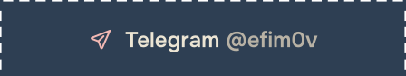
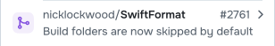
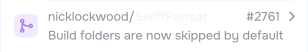
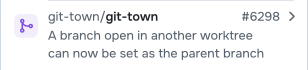
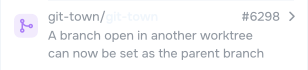
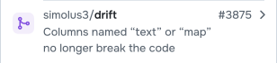
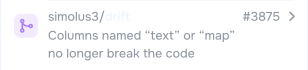
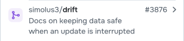

   
  

 

## Open source

Small tools I made or look after and share with the developer community. Free for anyone&nbsp;to&nbsp;use.

<a href="https://github.com/efim0v/brow"><picture><source media="(min-width: 1240px)" srcset="assets/tool-brow-v4-gap.svg" width="33.7494%"><source media="(min-width: 1012px)" srcset="assets/tool-brow-v4-gap.svg" width="50.9549%"><source media="(min-width: 905px) and (max-width: 1011.98px)" srcset="assets/tool-brow-v4-gap.svg" width="50.9549%"><source media="(min-width: 617px) and (max-width: 767.98px)" srcset="assets/tool-brow-v4-gap.svg" width="50.9549%"></picture></a><a href="https://github.com/Mizzle-Studio/keycloak-event-listener-rabbitmq"><picture><source media="(min-width: 1240px)" srcset="assets/tool-keycloak-v2-gap.svg" width="33.7494%"><source media="(min-width: 1012px)" srcset="assets/tool-keycloak-v2.svg" width="48.9951%"><source media="(min-width: 905px) and (max-width: 1011.98px)" srcset="assets/tool-keycloak-v2.svg" width="48.9951%"><source media="(min-width: 617px) and (max-width: 767.98px)" srcset="assets/tool-keycloak-v2.svg" width="48.9951%"></picture></a><a href="https://github.com/efim0v/uhabits"><picture><source media="(min-width: 1240px)" srcset="assets/tool-loop-v2.svg" width="32.4513%"><source media="(min-width: 1012px)" srcset="assets/tool-loop-v2.svg" width="48.9951%"><source media="(min-width: 905px) and (max-width: 1011.98px)" srcset="assets/tool-loop-v2.svg" width="48.9951%"><source media="(min-width: 617px) and (max-width: 767.98px)" srcset="assets/tool-loop-v2.svg" width="48.9951%"></picture></a>

### Contributions

Fixes I sent to projects I use, merged by their maintainers.

<a href="https://github.com/rxhanson/Rectangle/pull/1911"><picture><source media="(prefers-color-scheme: dark)" srcset="assets/contrib/none.svg" width="0" height="0"><source media="(min-width: 1154px)" srcset="assets/contrib/rectangle-1911-w-l-601ba56.svg"><source media="(min-width: 880px)" srcset="assets/contrib/rectangle-1911-m-l-6a8dc51.svg"><source media="(min-width: 768px)" srcset="assets/contrib/rectangle-1911-n-l-0cb49ac.svg"><source media="(min-width: 592px)" srcset="assets/contrib/rectangle-1911-m-l-6a8dc51.svg"><source media="(min-width: 462px)" srcset="assets/contrib/rectangle-1911-n-l-0cb49ac.svg"></picture><picture><source media="(prefers-color-scheme: light)" srcset="assets/contrib/none.svg" width="0" height="0"><source media="(min-width: 1154px)" srcset="assets/contrib/rectangle-1911-w-d-c963b54.svg"><source media="(min-width: 880px)" srcset="assets/contrib/rectangle-1911-m-d-dfa0788.svg"><source media="(min-width: 768px)" srcset="assets/contrib/rectangle-1911-n-d-19cd655.svg"><source media="(min-width: 592px)" srcset="assets/contrib/rectangle-1911-m-d-dfa0788.svg"><source media="(min-width: 462px)" srcset="assets/contrib/rectangle-1911-n-d-19cd655.svg"></picture></a> 
<a href="https://github.com/nicklockwood/SwiftFormat/pull/2761"><picture><source media="(prefers-color-scheme: dark)" srcset="assets/contrib/none.svg" width="0" height="0"><source media="(min-width: 1154px)" srcset="assets/contrib/swiftformat-2761-w-l-bb269b9.svg"><source media="(min-width: 880px)" srcset="assets/contrib/swiftformat-2761-m-l-8d2ef89.svg"><source media="(min-width: 768px)" srcset="assets/contrib/swiftformat-2761-n-l-0271f05.svg"><source media="(min-width: 592px)" srcset="assets/contrib/swiftformat-2761-m-l-8d2ef89.svg"><source media="(min-width: 462px)" srcset="assets/contrib/swiftformat-2761-n-l-0271f05.svg"></picture><picture><source media="(prefers-color-scheme: light)" srcset="assets/contrib/none.svg" width="0" height="0"><source media="(min-width: 1154px)" srcset="assets/contrib/swiftformat-2761-w-d-9c0f0e9.svg"><source media="(min-width: 880px)" srcset="assets/contrib/swiftformat-2761-m-d-158a73f.svg"><source media="(min-width: 768px)" srcset="assets/contrib/swiftformat-2761-n-d-df70444.svg"><source media="(min-width: 592px)" srcset="assets/contrib/swiftformat-2761-m-d-158a73f.svg"><source media="(min-width: 462px)" srcset="assets/contrib/swiftformat-2761-n-d-df70444.svg"></picture></a> 
<a href="https://github.com/git-town/git-town/pull/6298"><picture><source media="(prefers-color-scheme: dark)" srcset="assets/contrib/none.svg" width="0" height="0"><source media="(min-width: 1154px)" srcset="assets/contrib/git-town-6298-w-l-7e45475.svg"><source media="(min-width: 880px)" srcset="assets/contrib/git-town-6298-m-l-b30e46c.svg"><source media="(min-width: 768px)" srcset="assets/contrib/git-town-6298-n-l-36cf262.svg"><source media="(min-width: 592px)" srcset="assets/contrib/git-town-6298-m-l-b30e46c.svg"><source media="(min-width: 462px)" srcset="assets/contrib/git-town-6298-n-l-36cf262.svg"></picture><picture><source media="(prefers-color-scheme: light)" srcset="assets/contrib/none.svg" width="0" height="0"><source media="(min-width: 1154px)" srcset="assets/contrib/git-town-6298-w-d-1b01cad.svg"><source media="(min-width: 880px)" srcset="assets/contrib/git-town-6298-m-d-6a497d7.svg"><source media="(min-width: 768px)" srcset="assets/contrib/git-town-6298-n-d-b5c440c.svg"><source media="(min-width: 592px)" srcset="assets/contrib/git-town-6298-m-d-6a497d7.svg"><source media="(min-width: 462px)" srcset="assets/contrib/git-town-6298-n-d-b5c440c.svg"></picture></a> 
<a href="https://github.com/simolus3/drift/pull/3875"><picture><source media="(prefers-color-scheme: dark)" srcset="assets/contrib/none.svg" width="0" height="0"><source media="(min-width: 1154px)" srcset="assets/contrib/drift-3875-w-l-2b0377d.svg"><source media="(min-width: 880px)" srcset="assets/contrib/drift-3875-m-l-a7de7db.svg"><source media="(min-width: 768px)" srcset="assets/contrib/drift-3875-n-l-91345e7.svg"><source media="(min-width: 592px)" srcset="assets/contrib/drift-3875-m-l-a7de7db.svg"><source media="(min-width: 462px)" srcset="assets/contrib/drift-3875-n-l-91345e7.svg"></picture><picture><source media="(prefers-color-scheme: light)" srcset="assets/contrib/none.svg" width="0" height="0"><source media="(min-width: 1154px)" srcset="assets/contrib/drift-3875-w-d-4469647.svg"><source media="(min-width: 880px)" srcset="assets/contrib/drift-3875-m-d-3bc91e1.svg"><source media="(min-width: 768px)" srcset="assets/contrib/drift-3875-n-d-73cd5fb.svg"><source media="(min-width: 592px)" srcset="assets/contrib/drift-3875-m-d-3bc91e1.svg"><source media="(min-width: 462px)" srcset="assets/contrib/drift-3875-n-d-73cd5fb.svg"></picture></a> 
<a href="https://github.com/simolus3/drift/pull/3876"><picture><source media="(prefers-color-scheme: dark)" srcset="assets/contrib/none.svg" width="0" height="0"><source media="(min-width: 1154px)" srcset="assets/contrib/drift-3876-w-l-1400d97.svg"><source media="(min-width: 880px)" srcset="assets/contrib/drift-3876-m-l-9113ebc.svg"><source media="(min-width: 768px)" srcset="assets/contrib/drift-3876-n-l-2fae399.svg"><source media="(min-width: 592px)" srcset="assets/contrib/drift-3876-m-l-9113ebc.svg"><source media="(min-width: 462px)" srcset="assets/contrib/drift-3876-n-l-2fae399.svg"></picture><picture><source media="(prefers-color-scheme: light)" srcset="assets/contrib/none.svg" width="0" height="0"><source media="(min-width: 1154px)" srcset="assets/contrib/drift-3876-w-d-ffc79da.svg"><source media="(min-width: 880px)" srcset="assets/contrib/drift-3876-m-d-dafa2a3.svg"><source media="(min-width: 768px)" srcset="assets/contrib/drift-3876-n-d-13715fb.svg"><source media="(min-width: 592px)" srcset="assets/contrib/drift-3876-m-d-dafa2a3.svg"><source media="(min-width: 462px)" srcset="assets/contrib/drift-3876-n-d-13715fb.svg"></picture></a> 
<a href="https://github.com/scambier/obsidian-omnisearch/pull/585"><picture><source media="(prefers-color-scheme: dark)" srcset="assets/contrib/none.svg" width="0" height="0"><source media="(min-width: 1154px)" srcset="assets/contrib/obsidian-omnisearch-585-w-l-7c9d3cd.svg"><source media="(min-width: 880px)" srcset="assets/contrib/obsidian-omnisearch-585-m-l-ddc17f2.svg"><source media="(min-width: 768px)" srcset="assets/contrib/obsidian-omnisearch-585-n-l-7452e10.svg"><source media="(min-width: 592px)" srcset="assets/contrib/obsidian-omnisearch-585-m-l-ddc17f2.svg"><source media="(min-width: 462px)" srcset="assets/contrib/obsidian-omnisearch-585-n-l-7452e10.svg"></picture><picture><source media="(prefers-color-scheme: light)" srcset="assets/contrib/none.svg" width="0" height="0"><source media="(min-width: 1154px)" srcset="assets/contrib/obsidian-omnisearch-585-w-d-0d1d14c.svg"><source media="(min-width: 880px)" srcset="assets/contrib/obsidian-omnisearch-585-m-d-6f9c557.svg"><source media="(min-width: 768px)" srcset="assets/contrib/obsidian-omnisearch-585-n-d-e8a8b13.svg"><source media="(min-width: 592px)" srcset="assets/contrib/obsidian-omnisearch-585-m-d-6f9c557.svg"><source media="(min-width: 462px)" srcset="assets/contrib/obsidian-omnisearch-585-n-d-e8a8b13.svg"></picture></a> 
<a href="https://github.com/brendan-duncan/image/pull/812"><picture><source media="(prefers-color-scheme: dark)" srcset="assets/contrib/none.svg" width="0" height="0"><source media="(min-width: 1154px)" srcset="assets/contrib/image-812-w-l-b74b44b.svg"><source media="(min-width: 880px)" srcset="assets/contrib/image-812-m-l-d2db6fb.svg"><source media="(min-width: 768px)" srcset="assets/contrib/image-812-n-l-485fd07.svg"><source media="(min-width: 592px)" srcset="assets/contrib/image-812-m-l-d2db6fb.svg"><source media="(min-width: 462px)" srcset="assets/contrib/image-812-n-l-485fd07.svg"></picture><picture><source media="(prefers-color-scheme: light)" srcset="assets/contrib/none.svg" width="0" height="0"><source media="(min-width: 1154px)" srcset="assets/contrib/image-812-w-d-a45e7ca.svg"><source media="(min-width: 880px)" srcset="assets/contrib/image-812-m-d-71ecee7.svg"><source media="(min-width: 768px)" srcset="assets/contrib/image-812-n-d-5c538df.svg"><source media="(min-width: 592px)" srcset="assets/contrib/image-812-m-d-71ecee7.svg"><source media="(min-width: 462px)" srcset="assets/contrib/image-812-n-d-5c538df.svg"></picture></a> 
<a href="https://github.com/brendan-duncan/archive/pull/423"><picture><source media="(prefers-color-scheme: dark)" srcset="assets/contrib/none.svg" width="0" height="0"><source media="(min-width: 1154px)" srcset="assets/contrib/archive-423-w-l-939c4fe.svg"><source media="(min-width: 880px)" srcset="assets/contrib/archive-423-m-l-4266be5.svg"><source media="(min-width: 768px)" srcset="assets/contrib/archive-423-n-l-7390887.svg"><source media="(min-width: 592px)" srcset="assets/contrib/archive-423-m-l-4266be5.svg"><source media="(min-width: 462px)" srcset="assets/contrib/archive-423-n-l-7390887.svg"></picture><picture><source media="(prefers-color-scheme: light)" srcset="assets/contrib/none.svg" width="0" height="0"><source media="(min-width: 1154px)" srcset="assets/contrib/archive-423-w-d-771422a.svg"><source media="(min-width: 880px)" srcset="assets/contrib/archive-423-m-d-e18f490.svg"><source media="(min-width: 768px)" srcset="assets/contrib/archive-423-n-d-e0f7346.svg"><source media="(min-width: 592px)" srcset="assets/contrib/archive-423-m-d-e18f490.svg"><source media="(min-width: 462px)" srcset="assets/contrib/archive-423-n-d-e0f7346.svg"></picture></a>

